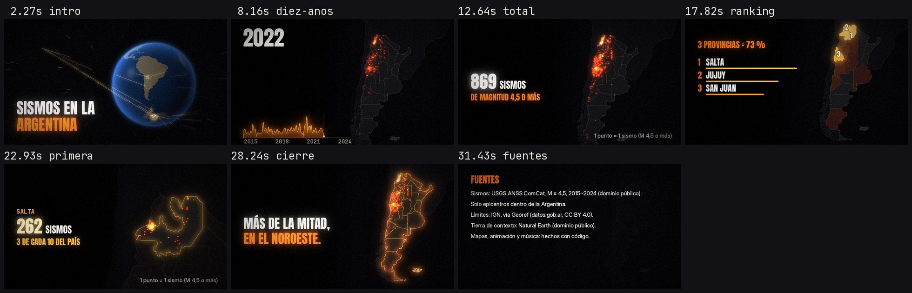

# data-video — a harness for data-story videos

One `story.yaml` + open data → a short video (≤ 60 s), readable on a phone, with every number verifiable.
Everything is drawn with code: map, globe, animation, typography and music. **No AI-generated images.**

Built to be used by a person or by a coding agent (Codex, Claude Code, Cursor): see [`AGENTS.md`](AGENTS.md).



## Quick start

```bash
cd harness
python -m venv .venv && . .venv/bin/activate
pip install -r requirements.txt          # Python 3.10+ and ffmpeg on the PATH

make check STORY=stories/sismos-argentina/story.yaml   # validate YAML, compute facts.json, check readability rules
make qa    STORY=stories/sismos-argentina/story.yaml   # stills + contact sheet + "phone" sheet + timing report
make video STORY=stories/sismos-argentina/story.yaml   # full render → stories/sismos-argentina/build/sismos-argentina.mp4
make test                                              # pytest: renders the small example end to end
```

Without `make`: `python -m harness check|qa|render|still <story>` · `python -m harness new "My story"` · `python -m harness beats`.

With Docker: `docker build -t data-video . && docker run --rm -v "$PWD:/app" data-video make video STORY=stories/sismos-argentina/story.yaml`

The **`stories/sismos-argentina/`** example (M ≥ 4.5 earthquakes with epicenter in Argentina, 2015–2024, USGS) ships its
data in the repo, uses no network and renders in ~1 minute at 960×540. Its on-screen text is in Spanish.

## How it works

```
data/ (open) ──► facts.py ──► build/facts.json ──► story.yaml (beats with {placeholders}) ──► rule check
                                                                                                    │
         build/<slug>.mp4 ◄── mux + −14 LUFS ◄── procedural music ◄── frames in parallel ◄──────────┘
```

1. **Data** (`data:` in the YAML): loaders for CSV / Parquet / GeoJSON / shapefile (points, regions), rasters
   (GeoTIFF/NPY), georeferenced images. Example adapters: NASA FIRMS (hotspots), MODIS MCD64A1 (burned
   area), Copernicus Sentinel-2 (single-date imagery) — see [`docs/data.md`](docs/data.md).
2. **Facts**: `facts.py` computes *every* number shown on screen → `build/facts.json`. The YAML uses them with
   `{name|filter}`, and every verbal rounding («casi» / "almost", «más de la mitad» / "more than half") carries an
   `assert`. A number typed by hand into a text **stops the build**.
3. **Beats** (scenes): `globe_intro`, `timeline`, `big_number`, `ranking`, `satellite_zoom`, `before_after`,
   `statement`, `closing`, `map`, `sources` → [`docs/beats.md`](docs/beats.md).
4. **Readability rules, in code** (the build fails with a clear message): text ≥ 48 px (at 1080p), ≤ 12 words on
   screen at once per scene, each text on screen ≥ 0.35 s/word + 1 s (min. 2.5 s), total duration ≤ `max_duration`.
5. **Audio**: music synthesized with numpy from each scene's timing + normalization to −14 LUFS
   (true peak ≤ −1.5 dBTP) with ffmpeg.
6. **QA**: contact sheet, phone-size sheet, timing report, duration and loudness of the mp4.

## Layout

```
harness/            the package (core/ drawing and map · beats/ scenes · data/ loaders and adapters · audio/ · qa · cli)
stories/            one folder per story: story.yaml, facts.py, data/, SOURCES.md, build/ (not committed)
templates/story/    what `harness new` copies
docs/               beats.md · data.md · style-guide.md · adding-a-beat.md
tests/              pytest (rules + render of the example)
```

## Project rules (summary of AGENTS.md)

- **Open data** only, with source and license in `SOURCES.md` and on the closing card.
- **No invented** or hand-typed numbers: everything comes from `facts.py` and has an `assert`.
- **No AI-generated images or video** (contests usually forbid them). Photos/satellite imagery only with an open license and credit.
- Videos and heavy raw data are not committed (`.gitignore`).

License: MIT (code). Example data keeps its own license (see `stories/*/SOURCES.md`).
